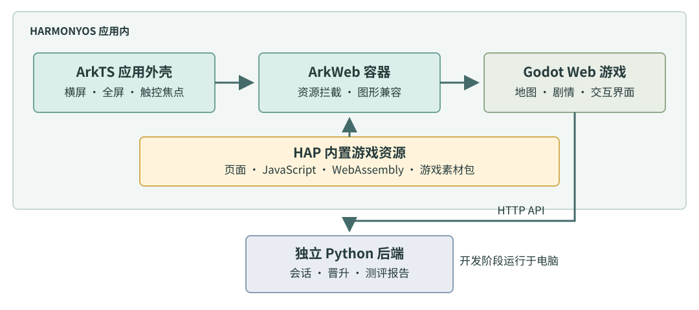
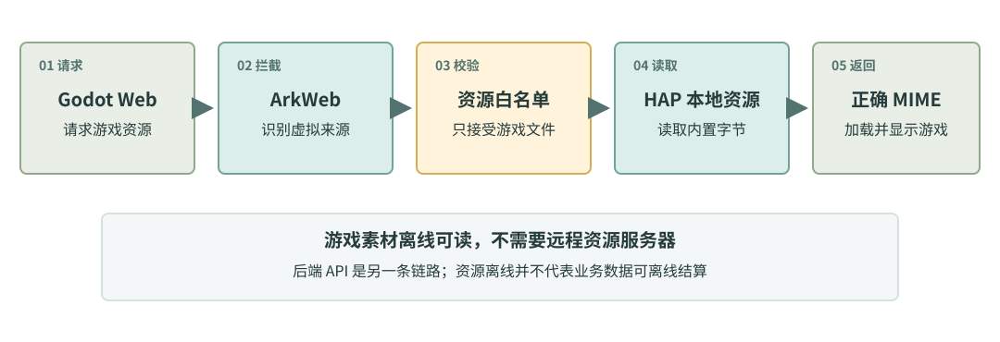
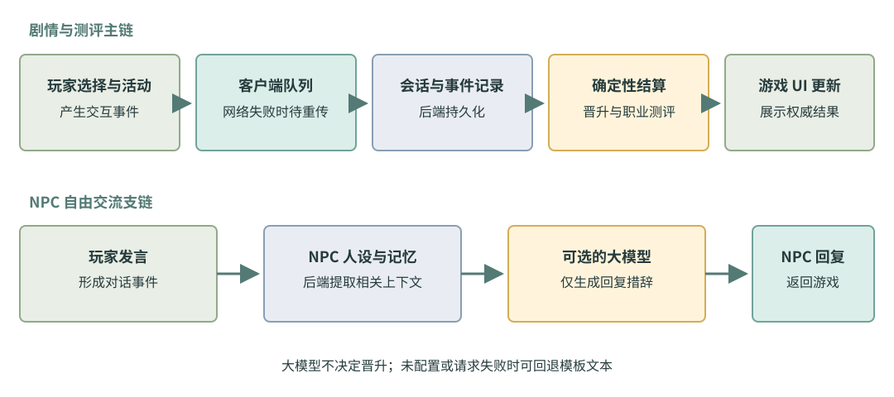
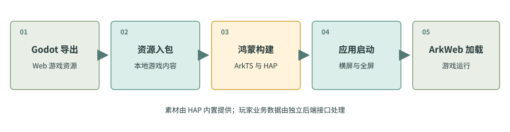

# 职场小镇 HarmonyOS 技术方案与实现

职场小镇将 Godot 制作的互动游戏集成到 HarmonyOS 应用中。我们使用 ArkTS 管理应用窗口与游戏容器，使用 ArkWeb 加载内置的 WebAssembly 游戏资源，并以独立后端处理会话、晋升结算和测评报告。该方案保留了游戏引擎的内容制作能力，同时针对鸿蒙设备完成资源加载、触控和图形兼容适配。

## 一 整体技术架构

游戏内容在 Godot 中制作并导出为 Web 运行资源。HarmonyOS 应用由 ArkTS 编写，ArkWeb 承载游戏页面；页面、脚本、WebAssembly 程序和美术素材随 HAP 一起打包。Python 后端保存玩家会话与行为事件，计算晋升结果并生成职业测评。大模型负责结合 NPC 人设和记忆生成自然语言回复，评分规则仍由后端控制。

ArkTS 负责应用生命周期、窗口、资源供应和运行状态提示；Godot 负责地图、剧情、角色和交互界面；后端负责持久化和结算。三个部分通过清晰接口协作，游戏画面与业务判定各由相应模块承担。

## 二 HarmonyOS 应用层实现

**窗口与交互适配。** 应用创建窗口后设置横屏和全屏布局，并隐藏系统栏，为地图与触控操作保留完整显示区域。ArkWeb 页面加载完成后聚焦游戏画布；用户触摸页面时再次设置焦点，使从系统界面返回后的触控能够继续传给游戏。

**HAP 本地资源加载。** Godot Web 运行时会请求页面、脚本、WebAssembly 和素材包。我们让 ArkWeb 使用应用内的虚拟 HTTPS 来源，拦截资源请求，核对资源白名单，从 HAP 读取对应字节，并按类型返回媒体格式。游戏素材由安装包提供，不依赖远程素材服务器。

**WebGL2 图形兼容。** 在部分鸿蒙运行环境中，我们定位到 uniform block 名称反射异常：引擎按原名查询时无法取得正确索引。兼容逻辑先执行原查询，仅在命中特定异常且原查询失败时恢复索引，避免改变正常环境的渲染路径。ArkTS 页面同时检查 WebGL2 能力，并对资源失败、图形错误及渲染进程退出提供明确提示。

## 三 游戏事件与测评数据流

玩家的剧情选择、活动和 NPC 对话形成事件。客户端保存待发送事件并在网络恢复后继续提交；后端确认会话、记录行为、维护权威状态。每六个月的晋升检查根据已记录行为按规则结算，最终测评报告从同一会话数据生成。界面直接展示后端返回的能力、关系、晋升和报告结果。

NPC 交流走独立支链：后端读取角色设定和相关记忆，组织对话上下文，再请求大模型生成回复。大模型仅负责表达，不决定晋升分数；未配置模型服务或请求失败时，后端使用角色模板回复。密钥留在后端运行环境，不进入 HAP。

## 四 构建与运行流程

我们先将 Godot 游戏导出为 Web 资源，再将资源放入 HarmonyOS 应用包。DevEco Studio 使用 Hvigor 编译 ArkTS 并构建 HAP；应用启动后创建横屏窗口，ArkWeb 通过本地资源映射加载游戏。游戏业务接口与素材加载相互独立，后端按会话提供数据服务。

开发联调时，Python 后端运行在电脑上，设备通过 USB 反向端口访问本机接口；后端针对游戏页面的虚拟来源处理跨域请求。由此，游戏画面资源在设备内加载，选择、聊天、晋升和报告则通过 API 交换数据。

整个实现将 ArkTS 窗口与触控适配、ArkWeb 包内资源映射和 WebGL2 图形兼容结合起来。Godot 游戏内容与后端测评系统保持独立，既复用已有游戏制作流程，也让职业测评以服务端会话数据为准。
